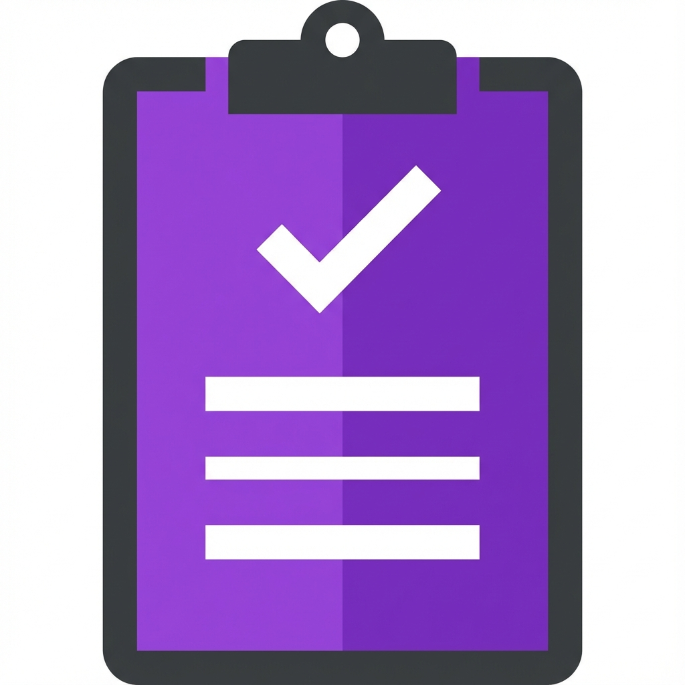
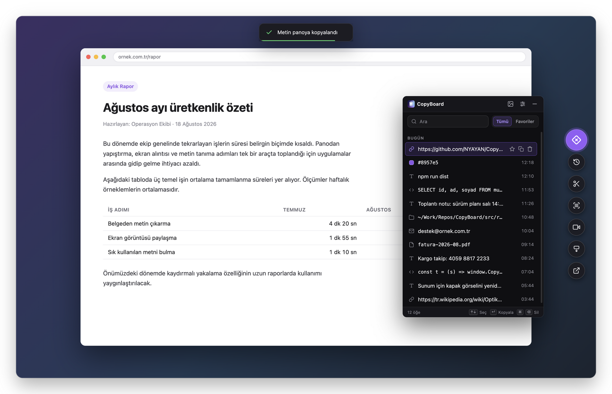
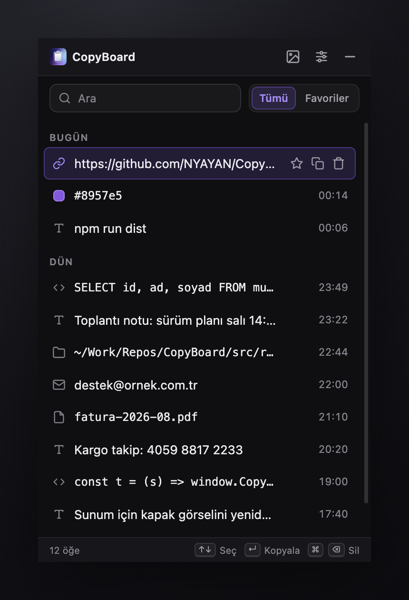
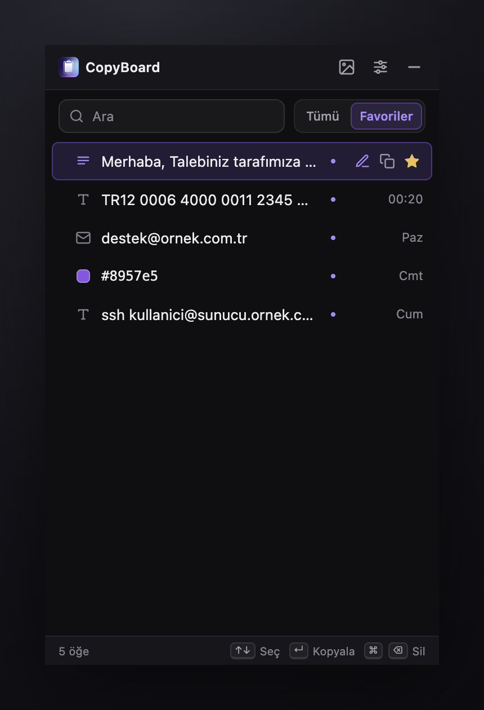
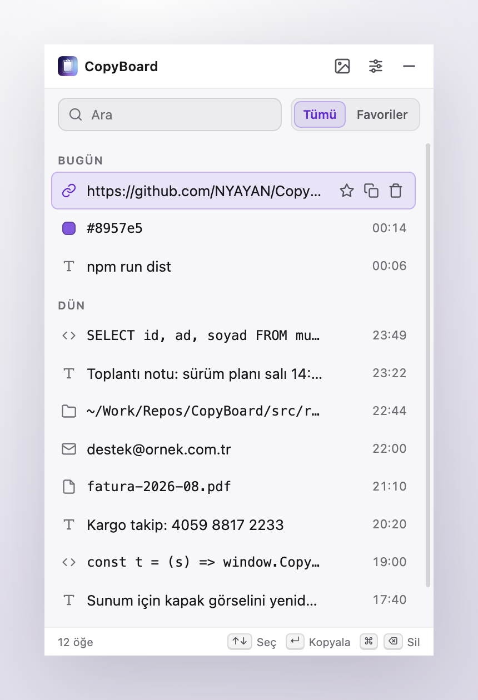
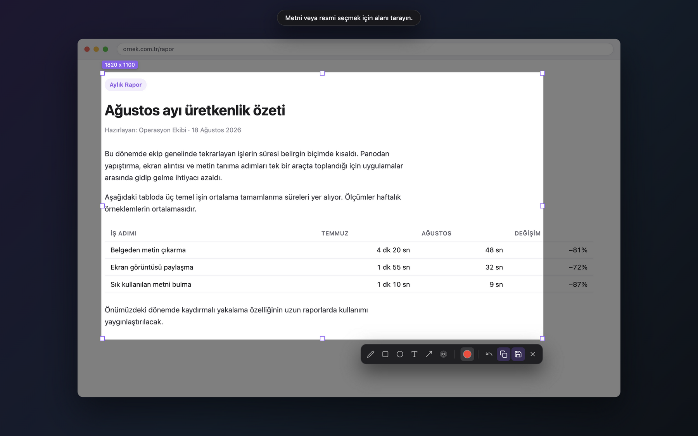
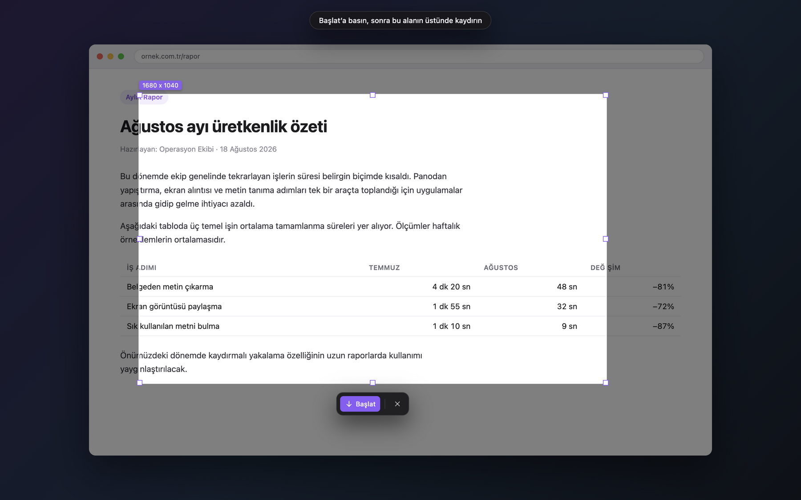
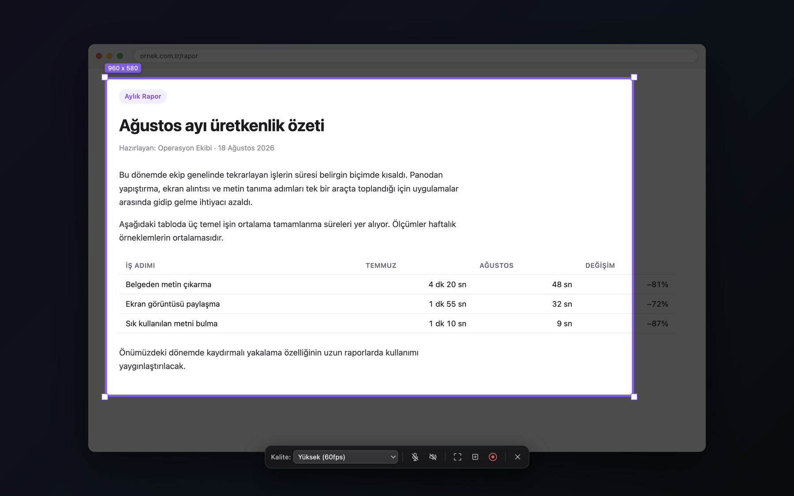
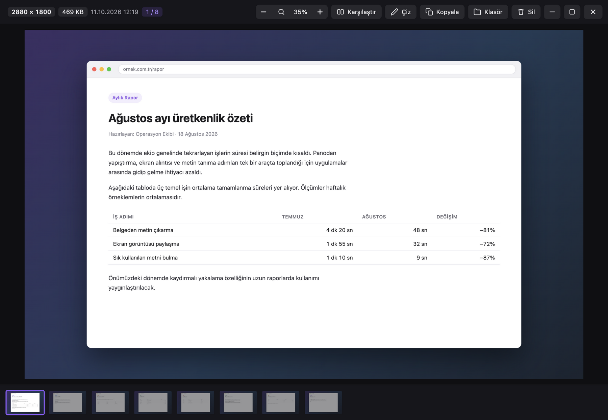
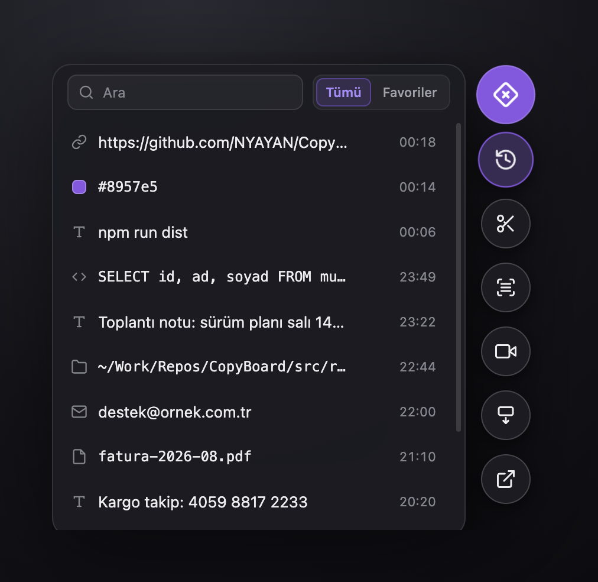

<div align="center">



# CopyBoard

**Kopyaladığınız her şeyi hatırlayan pano; ekran görüntüsü, metin tanıma ve ekran kaydı aynı uygulamada.**

macOS ve Windows için · Türkçe ve İngilizce arayüz · Ücretsiz ve açık kaynak

[](https://github.com/NYAYAN/CopyBoard/releases/latest)
[](LICENSE)

**[İndir](https://github.com/NYAYAN/CopyBoard/releases/latest)** &nbsp;·&nbsp;
[Kurulum](#paketi-indirip-kurmak) &nbsp;·&nbsp;
[Öne çıkanlar](#öne-çıkanlar) &nbsp;·&nbsp;
[Kısayollar](#klavye-kısayolları) &nbsp;·&nbsp;
[Belgeler](#belgeler)



</div>

## Öne çıkanlar

### Pano geçmişi bir kısayol uzağınızda

Kopyaladığınız her metin geçmişe kaydedilir. Bağlantı, renk kodu, kod, dosya yolu
ya da e-posta olduğu türünden tanınır, kayıtlar günlere ayrılır. macOS'ta ⌥V,
Windows'ta Alt+V listeyi açar; yazmaya başlayınca arar, Enter'a basınca kopyalar.
Sık kullandığınız metinleri **Favoriler**'e alın ve her birine bir not ekleyin
("Müşteri mail taslağı", "Şirket IBAN" gibi). Geçmişi temizlediğinizde favoriler
yerinde kalır.

<p align="center">
  
  
  
</p>

### Hızlı yapıştır

Son kopyaladıklarınız imlecin yanında açılır (macOS'ta ⇧⌘V, Windows'ta
Ctrl+Shift+V). Seçtiğiniz öğe o an yazdığınız alana kendiliğinden yapıştırılır;
pencere değiştirmeniz gerekmez.

### Ekran alıntısı, metin okuma ve renk kodu

Ekranın bir bölümünü seçin, üzerine kalemle, kare, daire, ok ya da yazıyla not
düşün. Şifre veya kimlik gibi bilgileri bulanıklaştırabilirsiniz. Sonucu panoya
kopyalayın ya da PNG olarak kaydedin. **Metin oku** seçtiğiniz alandaki Türkçe ve
İngilizce yazıyı tanıyıp panoya koyar; tanıma bilgisayarınızda yapılır. **Renk kodu
al** ise büyüteçle bir pikseli seçmenizi sağlar ve hex kodunu (`#8957e5`) kopyalar.

<p align="center">
  
</p>

### Ekrana sığmayan sayfalar ve video

**Kaydırmalı yakalama:** alanı seçip **Başlat**'a basın, sonra sayfayı her
zamanki gibi kendiniz kaydırın. CopyBoard kareleri örtüşen yerlerinden birleştirir.
Sayfayla birlikte kaymayan başlık ve araç çubukları sonuçta yalnızca bir kez
görünür. Güvenle eşleşmeyen bir kare birleştirilmez ve kaç karenin atlandığı
sonunda size söylenir.

**Video kaydı:** tam ekranı ya da seçtiğiniz alanı WebM olarak kaydedin. Mikrofonu
ve sistem sesini ayrı ayrı açıp kapatabilirsiniz.

<p align="center">
  
  
</p>

### Galeri ve karşılaştırma

Aldığınız görüntüler uygulamanın içindeki galeride toplanır. Büyük
görüntüleyicide yakınlaştırabilir, görüntünün üzerine çizebilir ve kırpabilirsiniz;
alttaki şeritten diğer görüntülere geçilir. **Karşılaştır** iki ila beş görüntüyü
yan yana koyar. Panelleri tek tek ya da hepsini birlikte yakınlaştırabilirsiniz.

<p align="center">
  
</p>

### Yüzen araç

Ekranın kenarına yaslanan küçük bir düğme. Pano, ekran alıntısı, metin okuma,
kaydırmalı yakalama ve video kaydı buradan tek tıkla açılır. Geçmiş ve favoriler
de ana pencereyi açmadan düğmenin yanında belirir. Rengini, opaklığını ve
boyutunu Ayarlar'daki **Yüzen araç** bölümünden değiştirebilirsiniz.

<p align="center">
  
</p>

### Ve dahası

- **Kısayollar:** hepsi Ayarlar'daki **Kısayollar** bölümünden yeniden tanımlanabilir
  ya da tek tek kapatılabilir.
- **Tema ve dil:** koyu, açık ya da işletim sisteminin ayarını izleyen tema;
  Türkçe ve İngilizce arayüz. Değişiklikler anında uygulanır.
- **Gizli mod:** açıkken kopyaladıklarınız geçmişe kaydedilmez.
- **Arka planda çalışma:** CopyBoard bilgisayar açılınca başlar (Ayarlar'dan
  kapatılabilir), macOS'ta menü çubuğunda, Windows'ta bildirim alanında durur.
- **Güncelleme haberi:** açılışta yeni sürüm olup olmadığına bakar; varsa sürüm
  notlarıyla birlikte haber verir.

## Paketi indirip kurmak

Son sürüm: **[Releases › Latest](https://github.com/NYAYAN/CopyBoard/releases/latest)**.

**macOS 12+ (Apple Silicon):** `CopyBoard-<sürüm>-arm64.dmg` dosyasını açıp
CopyBoard'u **Uygulamalar** klasörüne sürükleyin. İlk açılışta macOS "Apple,
CopyBoard'un kötü amaçlı yazılım içermediğini doğrulayamadı" der
(*“CopyBoard” Not Opened*). **Bitti**'ye (*Done*) basın, sonra:

1. **Sistem Ayarları › Gizlilik ve Güvenlik**'i açın (*System Settings ›
   Privacy & Security*).
2. En alttaki **Güvenlik** bölümünde "CopyBoard engellendi" satırının yanındaki
   **Yine de Aç**'a (*Open Anyway*) basın.
3. Mac'inizin parolasıyla ya da Touch ID ile onaylayın. Bu onay yönetici yetkisi
   ister; standart bir kullanıcı hesabındaysanız macOS bir yöneticinin adını ve
   parolasını sorar.

macOS uygulamayı açmıyorsa, "hasarlı" diyorsa ya da **Yine de Aç** düğmesi
çıkmıyorsa: [macOS: ilk açılış](#macos-ilk-açılış).

**Windows 10/11:** `CopyBoard-Setup-<sürüm>.exe` dosyasını indirip çalıştırın;
kurulum sihirbazında hedef klasörü değiştirebilirsiniz. Paket imzasız olduğu için
Windows "Windows bilgisayarınızı korudu" (*Windows protected your PC*) diyebilir:
**Ek bilgi** (*More info*) › **Yine de çalıştır** (*Run anyway*).

**Güncellemeler.** Windows'ta yeni sürüm uygulamanın içinden indirilip kurulur.
macOS'ta güncelleme penceresindeki **İndir (GitHub)** düğmesi sürüm sayfasını açar.
Yeni `.dmg`'yi indirip CopyBoard'u Uygulamalar klasöründekinin üzerine sürükleyin.
Yeni sürüm de internetten indirildiği için ilk açılışta **Yine de Aç** adımı
tekrarlanır.

## macOS: ilk açılış

CopyBoard Apple'ın ücretli geliştirici sertifikasıyla değil, kendi imzasıyla
(ad-hoc) dağıtılıyor. macOS, internetten indirilen ve Apple'ın onaylamadığı bir
uygulamayı ilk açılışta durdurur; yukarıdaki **Yine de Aç** adımı bu yüzden gerekli.

**"Hasarlı" uyarısı ya da Yine de Aç düğmesi yoksa.** Bazı durumlarda macOS
uygulamanın hasarlı olduğunu söyleyip Çöp Sepeti'ne taşımayı önerir ve Sistem
Ayarları'nda **Yine de Aç** düğmesi hiç çıkmaz. Paket bozuk değildir; macOS'un
indirilen dosyaya koyduğu karantina işaretini kaldırmak yeterli. **Terminal**
uygulamasını açın (Uygulamalar › İzlenceler › Terminal) ve şunu yazın:

```bash
sudo xattr -dr com.apple.quarantine /Applications/CopyBoard.app
```

- `sudo` komutu yönetici yetkisiyle çalıştırır ve **Mac'inizin giriş parolasını**
  sorar. Parolayı yazarken ekranda hiçbir şey görünmez; bu normaldir, yazıp
  Enter'a basın.
- Hesabınız yönetici değilse `sudo` çalışmaz. Komutu yönetici hesabıyla
  çalıştırın ya da bilgisayarın yöneticisinden yardım isteyin.
- Uygulamayı Uygulamalar klasörü dışında bir yere koyduysanız komuttaki yolu ona
  göre değiştirin. CopyBoard'u Finder'dan Terminal penceresine sürüklerseniz yol
  kendiliğinden yazılır.

**İzinler.** CopyBoard her izni ilk gerektiğinde ister:

| İzin | Ne için |
|---|---|
| **Ekran Kaydı** (macOS 15 ve sonrasında *Ekran ve Sistem Sesi Kaydı*) | Ekran alıntısı, metin okuma, renk kodu, kaydırmalı yakalama ve video |
| **Erişilebilirlik** | Hızlı yapıştırın seçtiğiniz öğeyi odaktaki alana yapıştırması |
| **Mikrofon** | Video kaydına sesinizi eklemek (yalnızca mikrofonu açarsanız) |

İzinler *Sistem Ayarları › Gizlilik ve Güvenlik* altında. İzni verdikten sonra
**CopyBoard'u kapatıp yeniden açın**; macOS yeni izni zaten çalışan bir uygulamaya
uygulamaz. Erişilebilirlik izni verilmezse öğe yine panoya kopyalanır, ⌘V ile
elle yapıştırabilirsiniz.

Uygulama Apple sertifikasıyla imzalı olmadığı için macOS bu izinleri her yeni
sürümde yeniden sorar. Listede eski bir "CopyBoard" satırı kaldıysa onu `−` ile
silip izni yeniden verin.

## Klavye kısayolları

Her yerden, CopyBoard arka plandayken de çalışır:

| Ne yapar | macOS | Windows |
|---|---|---|
| Pano listesi | ⌥V | Alt+V |
| Hızlı yapıştır | ⇧⌘V | Ctrl+Shift+V |
| Ekran alıntısı | ⌥9 | Alt+9 |
| Metin oku (OCR) | ⌥2 | Alt+2 |
| Renk kodu al | ⌥3 | Alt+3 |
| Kaydırmalı yakalama | ⌥4 | Alt+4 |
| Video kaydı | ⌥8 | Alt+8 |

Pano listesinde:

| Ne yapar | macOS | Windows |
|---|---|---|
| Kopyala ve kapat | Return | Enter |
| Kopyala, pencere açık kalsın | ⌘Return | Ctrl+Enter |
| Favorilere ekle / çıkar | ⌘D | Ctrl+D |
| Seçili öğeyi sil | ⌘⌫ | Ctrl+Backspace |
| Pencereyi gizle | esc | Esc |

Hepsi Ayarlar'daki **Kısayollar** bölümünden değiştirilebilir. Galeri, ekran
alıntısı ve görüntüleyicideki kısayollar:
[docs/ozellikler.md](docs/ozellikler.md#klavye-kısayolları).

## Verileriniz

Pano geçmişi, favoriler, ayarlar ve galerideki ekran görüntüleri sizin
bilgisayarınızda, tek bir klasörde durur; hiçbir yere gönderilmez. Metin tanıma da
bilgisayarınızda yapılır. Uygulama yalnızca yeni sürüm olup olmadığını GitHub'dan
sorar.

| Sistem | Klasör |
|---|---|
| macOS | `~/Library/Application Support/CopyBoard` |
| Windows | `%APPDATA%\CopyBoard` |

Geçmiş varsayılan olarak son 50 kaydı tutar; bu sayı Ayarlar'daki **Maksimum
kayıt** ile değişir. PNG olarak kaydettiğiniz görüntüler ve video kayıtları,
kaydederken seçtiğiniz klasöre yazılır.

## Belgeler

| Belge | İçinde ne var |
|---|---|
| [Özellikler ve kullanım](docs/ozellikler.md) | Her özelliğin ayrıntısı, bütün ekranların görüntüleri ve tam kısayol listesi |
| [Geliştirme](docs/gelistirme.md) | Kaynaktan çalıştırma, proje yapısı, testler, paket üretme |
| [Sürüm akışı](RELEASE_GUIDE.md) | Yeni sürümün nasıl yayınlandığı |
| [İmzalama](SIGNING.md) | Windows ve macOS paket imzası |
| [Değişiklik günlüğü](CHANGELOG.md) | Sürümlerin teknik ayrıntısı |

CopyBoard [Electron](https://www.electronjs.org) ile yazıldı. Metin tanıma
[Tesseract.js](https://github.com/naptha/tesseract.js) ile, uygulamayla birlikte gelen
Türkçe ve İngilizce dil verisi kullanılarak yapılır.

## Lisans

[MIT](LICENSE) © 2025 Nurullah YAYAN
